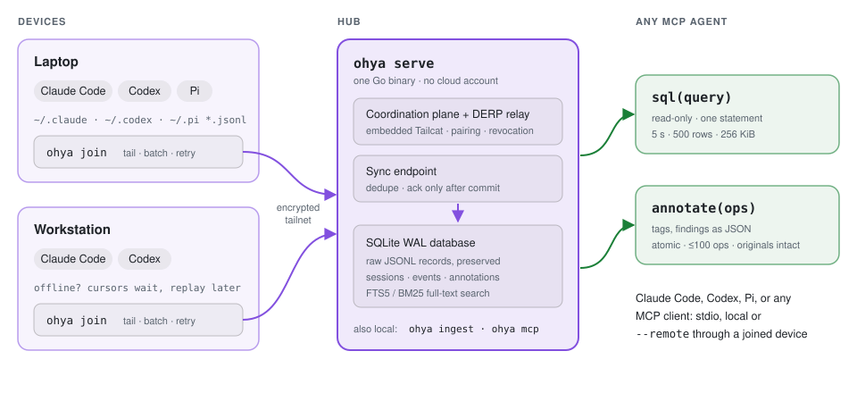

<div align="center">

<h1>
  <picture>
    <source media="(prefers-color-scheme: dark)" srcset="docs/assets/brand/logo-dark.svg">
    
  </picture>
</h1>

**One memory for all your coding agents. Everywhere.**

Claude Code, Codex, and Pi sessions from every machine in one searchable
SQLite database, served back to any agent over MCP.
One Go binary. No cloud account. No embeddings.

[](https://github.com/nibzard/ohya/actions/workflows/ci.yml)
[](LICENSE)
[](go.mod)


[Quick start](#quick-start) ·
[How it works](#how-it-works) ·
[Reference](docs/reference.md) ·
[Architecture](ARCHITECTURE.md) ·
[Contributing](CONTRIBUTING.md)

</div>

> [!IMPORTANT]
> ohya is pre-release. Install the [latest release](https://github.com/nibzard/ohya/releases/latest)
> with `install.sh`, or build from source. Ingestion, MCP tools, and device
> sync run end to end. macOS archives are not signed or notarized yet; a
> Homebrew tap is still open.

## Why ohya

Your agents produce decisions, debugging sessions, and unfinished work every
day. That context stays in one tool on one machine, until it is lost.

- **Cross-agent handoffs:** start in Claude Code, continue in Codex or Pi,
  and recover the earlier decisions, attempts, and unfinished work—even on
  another machine.
- **Local-first:** your transcripts stay on hardware that you own. Devices
  sync over an encrypted tailnet to a hub that you run.
- **Plain SQL:** agents query with `SELECT` and FTS5/BM25. There is no
  ingestion model, no vector store, and no AI pipeline.
- **Lossless:** every original JSONL record is kept byte for byte. Parser
  upgrades re-derive rows from the stored records.
- **Durable:** Claude Code deletes transcripts after 30 days by default
  (`cleanupPeriodDays`). ohya keeps every record that it has ingested.

## How it works

<picture>
  <source media="(prefers-color-scheme: dark)" srcset="docs/assets/architecture-dark.svg">
  
</picture>

1. **Capture:** `ohya ingest` (on the hub) or `ohya join` (on a device)
   tails `~/.claude`, `~/.codex`, and `~/.pi` session files.
2. **Sync:** batches go to the hub over an embedded Tailcat tailnet. The hub
   deduplicates records and acknowledges a cursor only after a durable
   commit. Offline devices replay when they reconnect.
3. **Store:** one SQLite WAL database keeps the raw records and the
   normalized sessions and events, with an FTS5 index.
4. **Recall:** any MCP client calls `sql` for bounded read-only queries and
   `annotate` to attach its own tags and findings.

<p align="center">
  
</p>

## Quick start

Install the latest release (macOS arm64/amd64, Linux amd64):

```sh
curl -fsSL https://github.com/nibzard/ohya/releases/latest/download/install.sh | sh
```

The release-hosted installer downloads the matching binary, verifies its
archive checksum, installs it in `~/.local/bin`, and runs setup. Setup
registers MCP integrations for detected agents and starts a user service
that imports existing history and follows new records. No Go toolchain is
needed.

Open a new terminal, then check the installation:

```sh
ohya version
ohya doctor
```

Start a new Claude Code, Codex, or Pi session and try:

> Use ohya to find the last work on this repository. What did the previous
> agent decide, what did it try, and what remains unfinished? Cite event IDs
> and check the current files before continuing.

The first history import can take time. For memory across machines, follow
[Share memory across machines](#share-memory-across-machines) below.

### Build from source

Building from source requires Go 1.27.3 or later, CGO, and a C compiler
(Xcode Command Line Tools on macOS, `build-essential` on Debian or Ubuntu).

```sh
git clone https://github.com/nibzard/ohya && cd ohya
make build
./bin/ohya setup --dry-run   # show the changes setup will make
./bin/ohya setup             # ingestion service + MCP entries for detected agents
./bin/ohya doctor            # check the result
```

<details>
<summary>Manual setup (no service, no client changes)</summary>

```sh
./bin/ohya ingest --once     # import existing history, then exit
./bin/ohya ingest            # or: keep polling until stopped
```

Register the MCP server in your agent, for example in Claude Code:

```json
{
  "mcpServers": {
    "ohya": { "command": "/absolute/path/to/bin/ohya", "args": ["mcp"] }
  }
}
```

</details>

### Share memory across machines

Two steps and one shared code
([ADR 0012](docs/adr/0012-two-step-multi-machine-setup.md)):

1. On the hub machine, run:

   ```sh
   ohya setup --hub
   ```

   Setup keeps local ingestion, adds an owned `ohya serve` user service,
   creates the hub identity, checks that a relay answers, and prints a
   one-time join code together with the device command.

2. On each other machine, paste the printed command:

   ```sh
   curl -fsSL https://github.com/nibzard/ohya/releases/latest/download/install.sh | sh -s -- --join
   ```

   The installer reads the code from the terminal (`/dev/tty`) without
   echo, so it stays out of shell history and the screen.

Agents and scripts pass the code through a variable instead:
`install.sh --join-code-env NAME` (nothing prompts under `--json`; without
a terminal the code must come that way). Both machines need outbound
internet access to meet through a relay; no reachable hub address,
certificate, or open port is required. Joined agents use
`ohya mcp --remote` and query the shared history on the hub. New codes at
any time: `ohya devices invite`. Revoke a device with
`ohya devices revoke ID`. See [serve and join](docs/reference.md#commands)
for the transport, join codes, and state directories.

## What agents can ask

Use ohya to recover context across agents and sessions:

- **Hand off work:** “Find what Claude Code last tried in this repository,
  including failed approaches and remaining work.”
- **Recall a fix:** “Have we seen this error before? Find the diagnosis and
  how the fix was verified.”
- **Understand a decision:** “Find the discussion behind this design and
  the alternatives we considered.”
- **Resume a project:** “Find the relevant prior sessions and summarize
  where work stopped.”

Agents should scope searches to the project, inspect the matching records,
and cite event IDs. Historical plans and reports need checking against
current files and tests before acting on them.

The `sql` tool publishes the schema and examples to the agent when it
connects. A typical recall query:

```sql
SELECT e.id, s.agent, s.cwd, substr(e.text, 1, 300) AS excerpt
FROM events_fts JOIN events_settled e ON e.id = events_fts.rowid
JOIN sessions s ON s.id = e.session_id
WHERE events_fts MATCH 'authentication AND refresh'
ORDER BY events_fts.rank LIMIT 10;
```

| Tool | Does | Bounds |
| --- | --- | --- |
| `sql(query)` | One `SELECT` or read-only `PRAGMA` on a read-only connection | 5 s, 500 rows, 256 KiB, explicit truncation |
| `annotate(operations)` | Upserts or deletes JSON annotations on events; originals stay unchanged | 100 operations, 64 KiB per value, atomic |

`events_settled` omits sessions that were active in the last 10 minutes, so
an agent does not read its own live transcript through this view. For an
immediate handoff from an active session, the receiving agent can query
`events` explicitly; settled recall becomes available after 10 minutes idle.

`sessions.repo` names the project as `host/path`, for example
`github.com/nibzard/ohya`, and it matches across devices even when the
working directory differs. Each device reads the git remote of its session
directories and sends only the normalized value to the hub.

## Commands

| Command | Purpose |
| --- | --- |
| `ohya setup` / `uninstall` | Configure or remove the service and agent integrations; memory stays; `--hub` also sets up device serving |
| `ohya ingest [--once]` | Import local session history, then poll for new records |
| `ohya mcp [--remote]` | Serve `sql` and `annotate` on stdio, locally or through a joined device |
| `ohya serve` | Run the hub: Tailcat transport and sync endpoint, no open port |
| `ohya join CODE` | Pair this device with a hub and upload its sessions |
| `ohya devices invite\|list\|revoke` | Manage paired devices |
| `ohya rederive` | Rebuild normalized rows after a parser upgrade |
| `ohya doctor` | Read-only health checks |
| `ohya status` | Runtime state from published local snapshots: freshness, backlog, resources |
| `ohya metrics` | Counter rates and duration quantiles over 1m/5m/1h/24h windows |
| `ohya logs` | Structured application logs from local instances, with `--follow` |
| `ohya diagnose` | Export one private, sanitized diagnostics artifact |
| `ohya usage` | Report how agents use the `sql` and `annotate` tools |
| `ohya version` | Build, parser, and schema versions |

Every command takes `--help`. Reporting commands take `--json`. No command
prompts for input. The [reference](docs/reference.md) describes the flags,
exit codes, and failure behavior.

## Security model

- Transcript content and SQL are untrusted. The SQL authorizer denies writes,
  `ATTACH`, extensions, and state-changing pragmas.
- Devices pair with one-time, expiring invitations. Revocation is final and
  is checked on every request.
- The hub sets the annotation writer from the authenticated device. A caller
  cannot set it.
- Sync and authorization state machines are model-checked with TLA+/TLC
  ([`tla/`](tla/README.md)).

## Status and roadmap

- **Works now:** Claude Code, Codex, and Pi ingestion; `sql` and `annotate`;
  pairing, sync, and revocation; remote MCP; integrated setup.
- **Open:** Developer ID signing and notarization for macOS; a Homebrew tap.
- **Next:** an OpenCode source (OpenCode stores sessions in SQLite).
- **Not planned:** embeddings, vector search, built-in AI classification,
  third-party AI processing.

See [BACKLOG.md](BACKLOG.md) for the full plan and [PRODUCT.md](PRODUCT.md)
for the product vision.

## Documentation

| Document | Contents |
| --- | --- |
| [Reference](docs/reference.md) | Commands, flags, MCP tools, setup, and the code map |
| [ARCHITECTURE.md](ARCHITECTURE.md) | System design and boundaries |
| [DB.md](DB.md) | Schema and migration policy |
| [Sync protocol](docs/sync-protocol.md) | Batches, cursors, and acknowledgments |
| [Performance](docs/performance.md) | Measured limits and benchmarks |
| [Release operations](docs/release-operations.md) | Release, backup, and recovery |
| [ADRs](docs/adr/) | Architecture decisions |
| [MANIFESTO.md](MANIFESTO.md) | Engineering principles |
| [BRAND.md](BRAND.md) | Logo, icon, colors, and usage |
| [TRADEMARKS.md](TRADEMARKS.md) | Use of the ohya name and marks |

## Contributing

Read [CONTRIBUTING.md](CONTRIBUTING.md) and [MANIFESTO.md](MANIFESTO.md),
then run:

```sh
make check   # gofmt, tests, and vet with the sqlite_fts5 build tag
```

## License

The code and documentation are MIT. See [LICENSE](LICENSE).

The ohya logo, wordmark, and icons in [`docs/assets/brand/`](docs/assets/brand/),
and the script that draws them, `scripts/brand-logo.py`, are not covered by
the MIT License. They are copyright Niko, all rights
reserved. See [BRAND.md](BRAND.md).

"ohya"™ and the elephant mark are trademarks of Niko. You can fork the code,
but a distributed fork must use a different name. See the
[trademark policy](TRADEMARKS.md).
