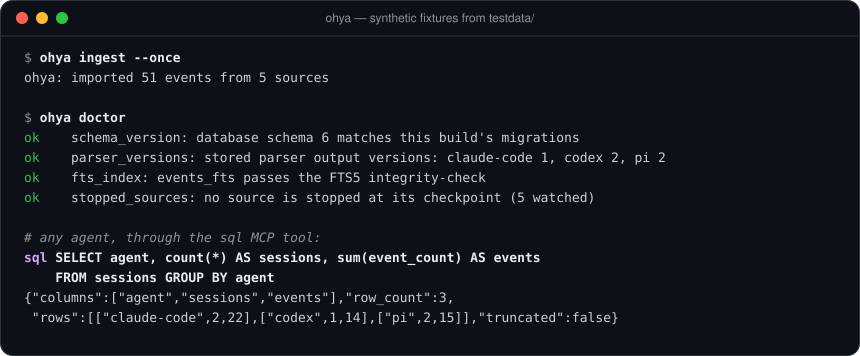

<div align="center">

<h1>
  <picture>
    <source media="(prefers-color-scheme: dark)" srcset="docs/assets/brand/logo-dark.svg">
    
  </picture>
</h1>

**One memory for all your coding agents. Everywhere.**

Claude Code, Codex, Pi, and Antigravity (`agy`) sessions from every machine in
one searchable SQLite database, served back to any agent over MCP.
One Go binary. No cloud account. No embeddings.

[](https://github.com/nibzard/ohya/actions/workflows/ci.yml)
[](LICENSE)
[](go.mod)


[Quick start](#quick-start) ·
[macOS app](#macos-menu-bar-app) ·
[How it works](#how-it-works) ·
[Compare](#how-ohya-compares) ·
[Reference](docs/reference.md) ·
[Architecture](ARCHITECTURE.md) ·
[Contributing](CONTRIBUTING.md)

</div>

Your agents make decisions, debug failures, and leave work unfinished every
day. That context stays in one tool on one machine, until it is lost. ohya
captures it and gives it back to the next agent:

- **Hand off across agents and machines.** Start in Claude Code, continue in
  Codex on another laptop, and recover what the first agent decided and tried.
- **Keep your data on your hardware.** Devices sync over an encrypted tailnet
  to a hub that you run. There is no third-party server.
- **Query with plain SQL.** Agents use `SELECT` and FTS5 full-text search
  through the `sql` MCP tool. There are no embeddings and no AI pipeline.

## Quick start

Install the latest release (macOS arm64/amd64, Linux amd64):

```sh
curl -fsSL https://github.com/nibzard/ohya/releases/latest/download/install.sh | sh
```

The installer downloads the matching binary, verifies its checksum, installs
it in `~/.local/bin`, and runs `ohya setup`. Setup registers ohya with each
detected agent (MCP entry and an `ohya` skill) and starts a user service that
imports existing history and follows new records. You do not need Go.

Open a new terminal and check the installation:

```sh
ohya doctor
```

Then start a new Claude Code, Codex, Pi, or Antigravity session and ask:

> Use ohya to find the last work on this repository. What did the previous
> agent decide, what did it try, and what remains unfinished? Cite event IDs
> and check the current files before continuing.

The first import of a large history can take some time. To share memory
between machines, see [Share memory across machines](#share-memory-across-machines).
On a Mac, the [menu bar app](#macos-menu-bar-app) can do this setup for you.

> [!NOTE]
> ohya is pre-release. Ingestion, MCP tools, and device sync run end to end.
> The macOS archives and the app are not signed with an Apple Developer ID
> or notarized yet, and there is no Homebrew tap yet.

## macOS menu bar app

`Ohya.app` is an optional native menu bar app for macOS 15 or later. It shows
whether capture runs and is caught up, searches memory, copies a handoff
prompt for the next agent, and manages paired devices. It controls ohya only
through the `ohya` command, and the launchd service keeps capture running
when the app is closed.

**New Mac:** the app holds its own `ohya`, so you do not need a terminal.

1. Download `Ohya_VERSION_macos.dmg` from the
   [latest release](https://github.com/nibzard/ohya/releases/latest), open it,
   and drag `Ohya.app` to Applications. Releases from v0.7.0 on include the
   app.
2. Open `Ohya.app`. The ohya mark appears in the menu bar.
3. Click the mark and choose one:
   - **Use this Mac** keeps the memory on this Mac.
   - **Join a hub** uploads this Mac's sessions to a hub that another
     machine runs. On the hub, run `ohya devices invite`, then paste the code
     into the secure field. The app passes the code to setup without a shell,
     so it stays out of shell history and process listings.

   The app installs `ohya` in `~/.local/bin`, runs setup, and shows the result
   of each step. Then start a new agent session, as in the
   [Quick start](#quick-start).

**Mac with ohya already installed:** open the app. It uses the installed
`ohya` (`~/.local/bin`, Homebrew, or `/usr/local/bin`) and needs no setup.
When the app holds a newer `ohya` release than the installed one, the Status
tab offers **Update**, which installs it and restarts capture.

Until the app is signed with a Developer ID, macOS blocks its first launch.
Open **System Settings → Privacy & Security** and click **Open Anyway** for
ohya, once. To build the app from source, see
[macos/OhyaMenuBar](macos/OhyaMenuBar/README.md).

## How it works

<picture>
  <source media="(prefers-color-scheme: dark)" srcset="docs/assets/architecture-dark.svg">
  
</picture>

1. **Capture:** `ohya ingest` (on the hub) or `ohya join` (on a device)
   tails `~/.claude`, `~/.codex`, `~/.pi`, and `~/.gemini/antigravity-cli/brain`
   session files.
2. **Sync:** batches go to the hub over an embedded Tailcat tailnet. The hub
   deduplicates records and acknowledges a cursor only after a durable
   commit. Offline devices replay when they reconnect.
3. **Store:** one SQLite WAL database keeps the raw records and the
   normalized sessions and events, with an FTS5 index.
4. **Recall:** any MCP client calls `sql` for bounded read-only queries and
   `annotate` to attach its own tags and findings.

<p align="center">
  
</p>

## What agents can ask

Use ohya to recover context across agents and sessions:

- **Hand off work:** “Find what Claude Code last tried in this repository,
  including failed approaches and remaining work.”
- **Recall a fix:** “Have we seen this error before? Find the diagnosis and
  how the fix was verified.”
- **Understand a decision:** “Find the discussion behind this design and
  the alternatives we considered.”
- **Resume a project:** “Find the relevant prior sessions and summarize
  where work stopped.”

Agents should scope searches to the project, inspect the matching records,
and cite event IDs. Historical plans and reports need checking against
current files and tests before acting on them.

The `sql` tool publishes the schema and core recall recipes to the agent
when it connects, while rare playbooks (`ohya://guides/garbage-audit` and
`ohya://guides/analytics-and-review`) are served on demand as MCP resources
and mirrored in the installed `ohya` skill. A typical recall query:

```sql
SELECT e.id, e.session_id, s.agent, s.cwd,
       datetime(e.time_ms/1000, 'unixepoch') AS utc_time,
       snippet(events_fts, 0, '[', ']', '...', 24) AS excerpt
FROM events_fts JOIN events_settled e ON e.id = events_fts.rowid
JOIN sessions s ON s.id = e.session_id
WHERE events_fts MATCH 'authentication AND refresh'
ORDER BY events_fts.rank LIMIT 10;
```

Agents use the MCP `sql` tool for interactive recall: it needs no shell
quoting, its result never mixes with stderr, it sits next to `annotate`,
and each call writes a usage record. For multi-step shell pipelines,
agents and operators can also run `ohya sql --json '<query>'` (or `-` for
stdin, `--remote` on a joined device), which routes through the exact same
read-only authorizer, row/byte bounds, and egress secret redaction as the
MCP tool.

| Surface | Does | Bounds |
| --- | --- | --- |
| `sql(query)` / `ohya sql` | One `SELECT` or read-only `PRAGMA` on a read-only connection | 5 s, 500 rows, 256 KiB, explicit truncation |
| `annotate(operations)` | Upserts or deletes JSON annotations on events; originals stay unchanged | 100 operations, 64 KiB per value, atomic |
| `ohya://guides/*` | On-demand MCP guide resources for garbage-audit and analytics/review | Loaded only when requested |

`events_settled` omits sessions that were active in the last 10 minutes, so
an agent does not read its own live transcript through this view. For an
immediate handoff from an active session, the receiving agent can query
`events` explicitly; settled recall becomes available after 10 minutes idle.

`sessions.repo` names the project as `host/path`, for example
`github.com/nibzard/ohya`, and it matches across devices even when the
working directory differs. Each device reads the git remote of its session
directories and sends only the normalized value to the hub.

## Share memory across machines

Two steps and one shared code
([ADR 0012](docs/adr/0012-two-step-multi-machine-setup.md)):

1. On the hub machine, run:

   ```sh
   ohya setup --hub
   ```

   Setup keeps local ingestion, adds an owned `ohya serve` user service,
   creates the hub identity, checks that a relay answers, and prints a
   one-time join code together with the device command.

2. On each other machine, paste the printed command:

   ```sh
   curl -fsSL https://github.com/nibzard/ohya/releases/latest/download/install.sh | sh -s -- --join
   ```

   The installer reads the code from the terminal (`/dev/tty`) without
   echo, so it stays out of shell history and the screen.

- **Networking:** both machines need only outbound internet access. They
  meet through a relay, so the hub needs no public address, certificate, or
  open port.
- **Scripts and agents:** pass the code in an environment variable with
  `install.sh --join-code-env NAME`. Nothing prompts under `--json`.
- **Recall:** agents on a joined device use `ohya mcp --remote` and query
  the shared history on the hub.
- **Devices:** issue a new code with `ohya devices invite`, and revoke a
  device with `ohya devices revoke ID`.

See [serve and join](docs/reference.md#commands) for the transport, join
codes, and state directories.

## Why ohya

- **Lossless while retained.** ohya keeps every original JSONL record byte
  for byte. A parser upgrade re-derives rows from the stored records
  (`ohya rederive`).
- **Durable.** Claude Code deletes transcripts after 30 days by default
  (`cleanupPeriodDays`). ohya keeps every record it ingested until you decide
  otherwise.
- **Owner-decided retention.** Nothing is deleted automatically. `ohya purge`
  plans a deletion (dry run by default) by session, repository, agent, age,
  or the garbage marks an agent placed with `annotate`. A purged source is
  refused until you re-admit it
  ([ADR 0013](docs/adr/0013-owner-scoped-session-purge.md),
  [ADR 0016](docs/adr/0016-agent-marked-purge-scope.md)).
- **Small context footprint.** The MCP schema that agents load up front is
  less than 8 KB. Rare playbooks for audits and analytics load on demand as
  MCP resources.
- **Checked sync.** The sync and authorization state machines are
  model-checked with TLA+/TLC ([`tla/`](tla/README.md)).

## How ohya compares

### Measured recall

We ran `cmd/recall-bench` on `glm-5.3` with 12 questions, 3 repeats each
(36 runs per setup, 180 s timeout). The questions cover needle lookups,
paraphrases, time windows, corrections, counts, multi-hop chains, verified
absence, and cross-device recall. Each setup answered from the same corpus:
raw transcripts on disk (`Bash`, `Grep`, `Read`), a local Atuin `v18.25.1`,
and ohya. Results from 2026-11-23:

| All 12 questions | Raw transcripts | Atuin v18.25.1 | **ohya** |
| :--- | ---: | ---: | ---: |
| Correct answers | 35 / 36 | 35 / 36 | **36 / 36** |
| Timeouts | 1 | 1 | **0** |
| Total wall time | 1,792 s | 1,235 s | **992 s** |
| Tool calls | 354 | 205 | **128** |
| Tool output read | 788 KB | 544 KB | **207 KB** |
| Total cost | $8.03\* | $5.25\* | **$4.53** |

Compared with raw transcript search, ohya used 45% less wall time, 74% less
tool output, and 44% less money, with no timeouts. It answered the
cross-device question in 23.4 s; Atuin took 165.5 s or timed out.

\*A run that timed out reported no final usage, so its cost is missing from
the total.

<details>
<summary>Local questions only, cache tokens, and cost per correct answer</summary>

The 11 questions that need no second device (33 runs per setup):

| Local questions | Raw transcripts | Atuin v18.25.1 | ohya |
| :--- | ---: | ---: | ---: |
| Correct answers | 33 / 33 | 33 / 33 | 33 / 33 |
| Total wall time | 1,263 s | **779 s** | 922 s |
| Tool calls | 279 | 127 | **117** |
| Tool output read | 524 KB | 197 KB | **182 KB** |
| Cache-read tokens | 3.06M | 1.89M | **1.79M** |
| Total cost | $6.05 | **$3.79** | $4.15 |
| Cost per correct answer | $0.183 | **$0.115** | $0.126 |

On simple local keyword lookups, Atuin's two-argument search tool was faster
and cheaper: writing SQL takes more output tokens than calling a fixed search
tool. A follow-up on the 5 affected questions, after the `v0.6.0` recipe
changes, cut ohya's wall time by a further 26% and its cost by 18%
($2.39 → $1.96), which closes most of that gap.

ohya also led on distinct-session counting (14.3 s and 0.3 KB, against
30.0 s and 2.3 KB for Atuin) and on verified absence (17.0 s and 2.5 KB,
against 31.6 s and 13.3 KB).

For all 12 questions, cache-read tokens were 5.05M (raw), 3.22M (Atuin), and
1.96M (ohya). Cost per correct answer was $0.229, $0.150, and $0.126.

</details>

### Atuin threads

[Atuin](https://atuin.sh) shipped "threads" in
[v18.24.0](https://github.com/atuinsh/atuin/releases/tag/v18.24.0)
(2026-10-15). It captures and searches the same Claude Code, Codex, and Pi
session files and serves them to agents over MCP. We checked these
differences against Atuin `v18.25.1`, its repository, and its issue tracker
on 2026-11-23:

| | Atuin threads v18.25.1 | ohya |
| :--- | :--- | :--- |
| Sharing | Single user. The "Threads for teams" beta uploads shared threads in plaintext to a hosted hub. | A hub that you run. One-time invitations, encrypted device sync, final revocation. |
| Fidelity | Compressed payloads; tool input and output clipped at 64 KiB; secrets replaced at capture. | Every original record kept byte for byte; secrets redacted when results leave the hub ([ADR 0015](docs/adr/0015-egress-secret-redaction.md)). |
| Recall surface | 6 fixed tools (about 16.9 KB of schema); needs a running daemon; no upper date bound, `OR`/`NOT`, model or device filters, or exact counts past 20 threads ([#4589](https://github.com/atuinsh/atuin/issues/4589)). | 2 tools (`sql`, `annotate`) under 8 KB; opens SQLite read-only with no daemon; dates, models, devices, and counts are one `WHERE` or `GROUP BY` ([recipes](DB.md#recall-recipes)). |
| Harnesses | No Antigravity. | Claude Code, Codex, Pi, and Antigravity. |
| Retention | No delete or purge command ([#4434](https://github.com/atuinsh/atuin/issues/4434)). | Owner-decided purge with source tombstones. |
| Verification | — | Sync and authorization model-checked with TLA+/TLC. |

## Build from source

Building from source requires Go 1.27.3 or later, CGO, and a C compiler
(Xcode Command Line Tools on macOS, `build-essential` on Debian or Ubuntu).

```sh
git clone https://github.com/nibzard/ohya && cd ohya
make build
./bin/ohya setup --dry-run   # show the changes setup will make
./bin/ohya setup             # ingestion service + MCP entries for detected agents
./bin/ohya doctor            # check the result
```

<details>
<summary>Manual setup (no service, no client changes)</summary>

```sh
./bin/ohya ingest --once     # import existing history, then exit
./bin/ohya ingest            # or: keep polling until stopped
```

Skip specific session files with a repeatable `--exclude GLOB` (stdlib
`path.Match` semantics, matched against absolute source paths); skipped
counts show in the pass summary and `ohya status`:

```sh
./bin/ohya ingest --exclude '/home/me/.codex/sessions/rollout-*-guardian-*'
```

Register the MCP server in your agent, for example in Claude Code:

```json
{
  "mcpServers": {
    "ohya": { "command": "/absolute/path/to/bin/ohya", "args": ["mcp"] }
  }
}
```

ohya installs no hooks and injects nothing into an agent session. The agent uses the memory only when the user asks for it.

</details>

## Commands

| Command | Purpose |
| --- | --- |
| `ohya setup` / `uninstall` | Configure or remove the service, agent MCP integrations, and owned `ohya` skill; memory stays; `--hub` also sets up device serving |
| `ohya service status\|start\|stop\|restart` | Inspect or control the owned background user service (`--hub` for `ohya serve`) |
| `ohya ingest [--once]` | Import local session history, then poll for new records |
| `ohya mcp [--remote]` | Serve `sql`, `annotate`, and on-demand guide resources on stdio, locally or through a joined device |
| `ohya sql QUERY [--remote] [--json]` | Run one bounded read-only SQL query (or `-` for stdin) through the `sql` tool engine |
| `ohya search QUERY [--repo] [--agent]` | Find sessions by keyword (BM25) and print excerpts, locally or through a joined device |
| `ohya show SESSION_ID [--last N]` | Print one session's newest events, excerpted |
| `ohya sessions [--limit N] [--repo] [--agent]` | List recent sessions and their settled state, locally or through a joined device |
| `ohya serve` | Run the hub: Tailcat transport and sync endpoint, no open port |
| `ohya join CODE` | Pair this device with a hub and upload its sessions |
| `ohya devices invite\|list\|revoke` | Manage paired devices |
| `ohya purge` | Plan or apply an owner-decided purge of stored sessions (dry run by default) |
| `ohya sources reallow` | Re-admit a purged source so its device syncs again |
| `ohya rederive` | Rebuild normalized rows after a parser upgrade |
| `ohya doctor` | Read-only health checks |
| `ohya status` | Runtime state from published local snapshots: freshness, backlog, resources |
| `ohya metrics` | Counter rates and duration quantiles over 1m/5m/1h/24h windows |
| `ohya logs` | Structured application logs from local instances, with `--follow` |
| `ohya diagnose` | Export one private, sanitized diagnostics artifact |
| `ohya usage` | Report how agents use the `sql` and `annotate` tools |
| `ohya secrets scan` | Count secret-shaped values in stored records; never prints matched text |
| `ohya version` | Build, parser, and schema versions |

Every command takes `--help`. Reporting commands take `--json`. No command
prompts for input. The [reference](docs/reference.md) describes the flags,
exit codes, and failure behavior.

## Security model

- Transcript content and SQL are untrusted. The SQL authorizer denies writes,
  `ATTACH`, extensions, and state-changing pragmas.
- The `sql` tool replaces secret-shaped values (AWS key ids, GitHub,
  Anthropic, OpenAI, Slack, and Google tokens, private-key blocks, and
  secret-named assignments) with kind-labeled markers before results leave
  the hub — best-effort risk reduction, never a guarantee; stored records
  stay untouched ([ADR 0015](docs/adr/0015-egress-secret-redaction.md)).
  `ohya secrets scan` reports what the same pattern table finds in stored
  records without ever printing matched text.
- Devices pair with one-time, expiring invitations. Revocation is final and
  is checked on every request.
- The hub sets the annotation writer from the authenticated device. A caller
  cannot set it.
- Sync and authorization state machines are model-checked with TLA+/TLC
  ([`tla/`](tla/README.md)).

## Status and roadmap

- **Works now:** Claude Code, Codex, Pi, and Antigravity (`agy`) ingestion;
  `sql`, `annotate`, on-demand MCP guide resources, and `ohya sql` CLI;
  pairing, sync, and revocation; remote MCP; integrated setup (including
  owned `ohya` agent skill); owner-scoped purge with source tombstones.
- **Works now on macOS:** the menu bar app with first-run setup and join,
  packaged as a universal DMG with its own `ohya`.
- **Open:** Developer ID signing and notarization for the macOS archives and
  app; a Homebrew tap for the formula and the app cask.
- **Next:** an OpenCode source (OpenCode stores sessions in SQLite).
- **Not planned:** embeddings, vector search, built-in AI classification,
  third-party AI processing.

See [BACKLOG.md](BACKLOG.md) for the full plan and [PRODUCT.md](PRODUCT.md)
for the product vision.

## Documentation

| Document | Contents |
| --- | --- |
| [Reference](docs/reference.md) | Commands, flags, MCP tools, setup, and the code map |
| [ARCHITECTURE.md](ARCHITECTURE.md) | System design and boundaries |
| [DB.md](DB.md) | Schema and migration policy |
| [Sync protocol](docs/sync-protocol.md) | Batches, cursors, and acknowledgments |
| [Performance](docs/performance.md) | Measured limits and benchmarks |
| [Release operations](docs/release-operations.md) | Release, backup, and recovery |
| [ADRs](docs/adr/) | Architecture decisions |
| [MANIFESTO.md](MANIFESTO.md) | Engineering principles |
| [BRAND.md](BRAND.md) | Logo, icon, colors, and usage |
| [TRADEMARKS.md](TRADEMARKS.md) | Use of the ohya name and marks |

## Contributing

Read [CONTRIBUTING.md](CONTRIBUTING.md) and [MANIFESTO.md](MANIFESTO.md),
then run:

```sh
make check   # gofmt, tests, and vet with the sqlite_fts5 build tag
```

## License

The code and documentation are MIT. See [LICENSE](LICENSE).

The ohya logo, wordmark, and icons in [`docs/assets/brand/`](docs/assets/brand/),
and the script that draws them, `scripts/brand-logo.py`, are not covered by
the MIT License. They are copyright Niko, all rights
reserved. See [BRAND.md](BRAND.md).

"ohya"™ and the elephant mark are trademarks of Niko. You can fork the code,
but a distributed fork must use a different name. See the
[trademark policy](TRADEMARKS.md).
